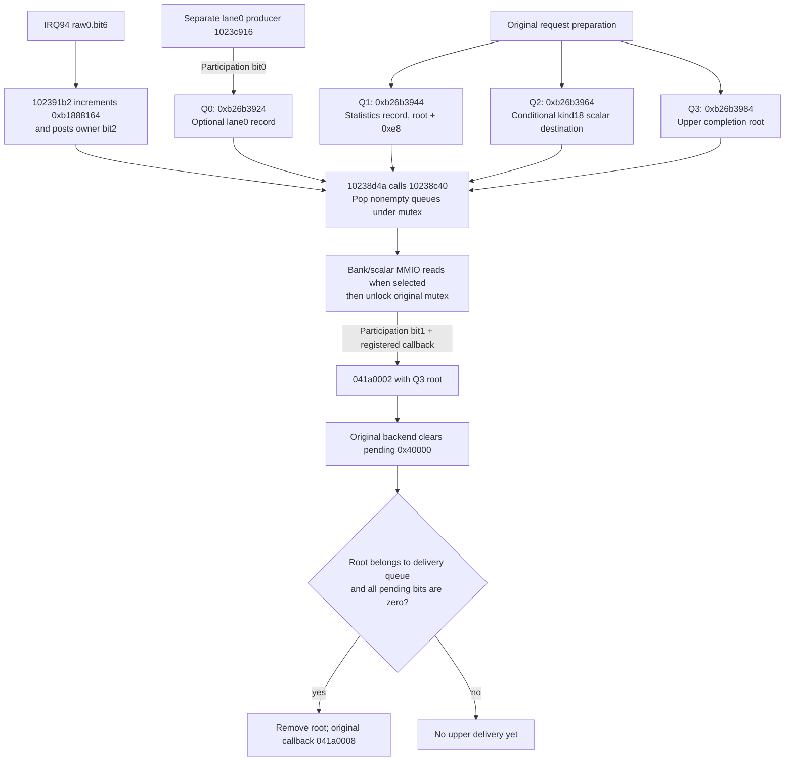

# Capture data completion and request retirement

This audit continues the [readout producer join](readoutstate.md#current-cold-neutral-producer-and-completion-join).
Code addresses and software objects below are original MAS VAs; device and
pool addresses are board PAs. Source projections, raw allocation rows and
unchanged-firmware receipts remain in `run capturedata/`.
The storage-only checkpoints below precede the implemented
[finite statistics transaction](../devices/statistics/protocol.md), which
now produces DMA/results/raw6 under explicit arithmetic/input assumptions.

## IRQ, queue and retirement flow

Queue links below describe guest-owned records, not a one-to-one mapping of
hardware frames to roots. The owner pops at most one entry from each nonempty
queue, and an empty queue can discard a completion. Addresses in this diagram
are MAS VAs; event and pending masks are hexadecimal.

The model supplies DMA, results and the interrupt cause. Queue removal,
pending-word changes and callbacks are performed only by original firmware.

## Established producer and consumer chain

IRQ94 callback `102391b2`, event41072800, treats raw0.bit6 (`40`) separately
from mode-dependent primary-readout bits3/5. Bit6 increments the software
counter at `b1888164` and posts owner bit2 (`4`) through `103606e4` to the
event object at `b26b38a8`. Owner `10238d4a` drains that counter by calling
`10238c40`. Neither a VD edge nor an auxiliary DMA completion by itself
establishes this distinct data-completion cause.

Normal submission `10235c84 -> 1023befe -> 1023bc02` allocates resource
handles, then takes mutex `b188815c` and appends the following records.
Offsets and masks are hexadecimal unless marked decimal; C array indices
such as root[16] are decimal DWORD indices.

| Queue VA | Submission | Consumption in `10238c40` |
|---|---|---|
| `b26b3924` | Separate producer `1023c916`, only participation bit0 | Optional lane0 record |
| `b26b3944` | Always `root+e8` (`root+58` DWORDs) | Statistics record |
| `b26b3964` | `root[28]+30` when byte `root[81]+5769` decimal is0 | Global scalar output |
| `b26b3984` | Always `root` | Upper completion payload |

The last three appends occur after the resource-preparation path reaches
the common tail; they do not await a hardware result. Kind17's handle is
allocated when `1023caf8(root)` and not `1023cb0a(root)`; kind18's handle
is allocated when not `1023cb0a(root)`. Q2 uses kind18's descriptor, not
kind17's. Queue word+c=4 is an allocation chunk, not a four-entry bound:
the linked queues actually contain33 entries in the final observations.

The consumer pops at most one entry from each nonempty queue. Aggregate
bit10 calls `10238c3e` on lane0 then the normal statistics record; bit20
reverses that order. `10238c3e -> 10238a82` consumes numerical results.
Aggregate bit8 also invokes `10238a62(0,Q2_payload)` when participation
bit2 is clear or byte `b1888147` is not1. After unlocking, participation
bit1 and a non-NULL callback at `b1888168` dispatch041a0002 with Q3's root.

In the observed lane1 configuration, aggregate=`2eb`, participation=`2`,
and `b1888168=1022e2e1` (Thumb entry `1022e2e0`). Its041a0002 case calls
`1022e1c2(1)` and then `1022e0ae(root,40000)` for a non-NULL root. The
latter finds the root in the backend queues and clears that pending bit at
root+14c. Only a root in queue `b25eec04` whose complete pending word becomes
zero is removed and delivered through callback `b1887e80=10321a4d` as
041a0008. The model must not directly clear this word or invoke a callback.

## Required data before completion

`10238a82` selects `1020c59c`/bank0 for aggregate bit10, or
`1020c608`/bank1 for bit20. Reader `10209f4a` consumes twelve32-bit words
from bank0 `2006a100..2006a12c` or bank1 `2006bf00..2006bf2c`. Each
bank's four triples are `{signed24,unsigned29,unsigned17}` with register
offset orders `{00,08,10}`, `{04,0c,14}`, `{18,20,28}`, `{1c,24,2c}`.
Original code sign-extends/masks them and writes the software statistics
record; the packed widths and ordering do not establish the arithmetic
that generates them from pixels. At this audit's storage-only checkpoint,
capture-bank devices retained configuration only. They now accept results
from the separate statistics coordinator.

`10238a62(0,p) -> 1020c876(0) -> 1020af08` reads `2006a3e0` into the
kind18 descriptor's word+30. Selectors0..3 address `a3e0/e4/e8/ec`.
Selector0 does **not** establish endpoint0, a ring index, a pixel count or
a result value of0. The four configuration rows beginning `a2c4/a2dc/
a2f4/a30c` are separate from those result words. Their association and
the global scalar's numerical meaning remain unresolved.

A functional processing profile may choose simplified arithmetic and
explicit input cadence; physical Bayer fidelity is not a prerequisite.
It still needs a coherent processing generation: lock unit16's selected
commit8 configuration, accept a definite input generation while effectively
running, produce required endpoint data and both result families, then
publish raw0.bit6 once through existing capture pending/IRQ/W1C. Duplicate
commit ports must not duplicate work; failed DMA, cancellation, stop, reset
and stale jobs must not publish completion. The later statistics profile
implements this contract, including raw6 pending/W1C backpressure. Empty
software queues may discard a completed frame; result reads therefore must
not gate the next job. Returning arbitrary results
or attaching bit6 to every auxiliary completion would retire requests
without satisfying their data dependencies.

## Complete source-declared pool storage

Initializer `10306fb0`, table `11982938`, selects the following24-byte pool
rows. All five override pointers for these rows are NULL in the inspected
original image. Pool sizes equal unit size times count.

| Kind | Row VA | PA base | Bytes | Unit bytes | Count |
|---|---|---|---|---|---|
|17|`119832d8`|`5d134000`|`3c000`|`a000`|6|
|18|`119832f0`|`5d170000`|`6c000`|`12000`|6|
|19|`11983308`|`5d1dc000`|`144000`|`36000`|6|
|20|`11983320`|`afa00000`|`43800`|`10e00`|4|
|21|`11983338`|`5d320000`|`195000`|`65400`|4|
|22|`11983350`|`afc3dc00`|`60000`|`18000`|4|
|23|`11983368`|`5d4b5000`|`3c00`|`c00`|5|

Pool constructors `1030ab92/ad70/af00/b0ee/b9aa/b2ce` establish the
17..22 family; capture-group's `10239dc6` uses kind23. Kind18 already has
its [grid region](grid.md); this change backs the other six complete
extents using the existing offset-aware RAM helper. Source row lengths and
address translations remain unchanged. Adjacent pools are separate regions,
not a broad DDR aperture. Cold-zero RAM is an explicit functional assumption;
it produces no statistics, DMA, scalar, status or IRQ. Kind18's alternate
kind32 allocation for large requested slot counts is outside this addition.

Endpoint metadata builder `1023a63c` and setters `1020b142/1020b16a` explain
word48 as count-minus1 and word80 as unit stride in this configured family.
The observed values5/3 are not established pixel-format numbers. Kind17
parser `102ce5aa` establishes an aligned pitch from configuration columns;
it does not recover the cell arithmetic or the distinct kind18 scalar.

## GUI relationship and unchanged execution

Callback `10321a4c`, case041a0008 at `10321d80..10321e24`, first tests
root[8], then requires **root[16] !=0** for its image-delivery branch.
That branch can enqueue into `b23ef3c8` or select `root[26]+24` according
to software state `b1868b1e`; roots without this flag go through
`1032a792(root,1)` recycling. This proves a conditional connection to upper
image delivery, not that every bit6 completion produces a GUI main image.
The direct producer is `103250f2:1032530a -> 10324f04(root+8)`.
Its output `a1[14]` is therefore root[16]: it writes1 only when software byte
`b1868af6` equals1 and counters `b1868b94` and `b1868b98` differ, then
increments the former counter. Otherwise it writes0; equality while in state1
also changes `b1868af6` to2. The read-only `routes` snapshot has
`b1868af6=0`; at that sampled state the setter would select the zero branch.
Its per-request execution state was not traced. The
later [upstream request audit](../devices/statistics/protocol.md#separate-software-image-request-condition)
identifies `103f27ba -> 10328ca6 -> 10323a7e`, guarded by service state9
and property1053=1. The eventual connection to GUI main-image delivery
remains unresolved; this conditional branch is not itself proof of normal
live-view GUI output. Root[8], separately, requires `b1868b0c=2` in the same
setter; the latest state has that byte0 as well.

The post-change `verified` and `routes` runs each use unchanged firmware,
the same cold-neutral descriptor32, RNG0, healthy paced battery UART, held
cold F4 and5 CPUs under MTTCG. After20 host seconds both remain running,
with no uncovered access, no peer rejection and no display console. The
six original loader COPY ranges compare, guard=0 and property6433 is empty.
Sequential QMP reads report1662/1662 and1640/1640 accepted/completed
auxiliary requests respectively, with zero rejections. These are functional
transfers, not GUI frames or physical cadence.

Each snapshot has queue lengths0/33/33/33. Thirty-two roots have pending
`40000`; the newest has `40001`. `routes` checks all33 roots: root[8] and
root[16] are both0 in every one. Mask `20068200=10000079` already enables
raw0.bit6, reset is0, enable/run=`2bf`, and mode=`10008`. The focused trace
sees owner bit29 but no bit2, no `10238c40` entry and no statistics-reader
entry. The primary auxiliary prefix is nonzero; the secondary stays cold.
Thus queue submission and IRQ masking were not the missing edge. That
storage-only model lacked processing-data/results and raw0.bit6; its queued
roots also have not selected the upper image-delivery branch. No new startup
stop or normal-GUI progress is claimed from adding storage alone.

Native evidence is separate: old-model DMA fails at the first new pool,
then the complete `nikon_memory` batch passes32 subtests. The added case
checks all29 new slots, distinct first/last words, unaligned DMA spanning a
backing-page boundary, reset preservation and the outer unmapped boundaries.
The old kind18 test's two former holes are now valid neighboring pools;
their actual outer boundaries are checked by the family test.
