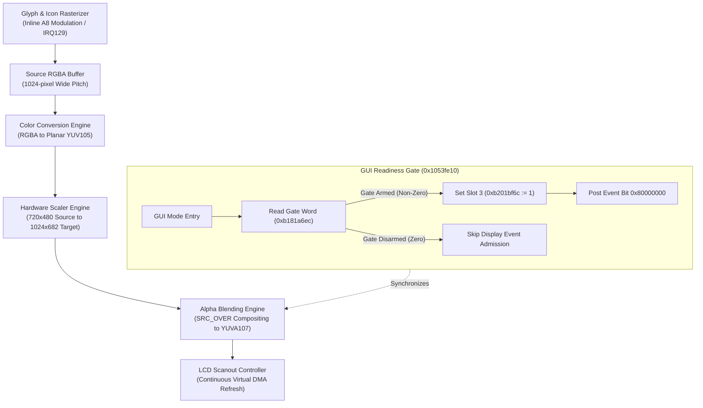

# Display pipeline, graphics compositing, and GUI readiness

This specification details the multi-stage display composition pipeline, color format conversions, and kernel readiness gates that govern LCD output generation in the Nikon Z7II C1.70 MAS firmware.

## Graphics compositing architecture

The graphics pipeline renders vector glyphs, scales source layers, performs color space conversion, and alpha-blends the final GUI image into the primary scanout buffer.



## Composition pipeline stages

### 1. Vector glyph and icon rasterization
- **Font & Icon Engine**: Unchanged firmware decodes vector outline glyphs from ROM and executes inline A8 image modulation through the graphics coprocessor.
- **Interrupt Signaling**: Completion is signaled via GIC IRQ129, releasing the rendering worker thread.
- **Rendering Targets**: Cleared RGBA panels receive rendered text and warning icon assets in memory.

### 2. Format conversion (RGBA to YUV105)
- **Geometry**: The 224/1736-byte graphics descriptor converts a 1024-pixel pitch RGBA source buffer into planar YUV105 format.
- **Conversion Law**: Digital color-matrix hardware executes standard Rec.601/709 conversion equations with fixed-point matrix coefficients.

### 3. Scaling and SRC_OVER composition
- **Bilinear Scaler**: The hardware scaling engine expands 720x480 resolution frames into 1024x682 YUVA107 composite buffers.
- **Alpha Blending**: The 176/1552-byte continuation descriptor executes Porter-Duff `SRC_OVER` alpha compositing, merging rendered UI overlays with video/stills surfaces.

## GUI readiness state machine and gating

Display refresh synchronization requires passing the GUI readiness gate in `0x1053fe10`:

```armasm
1054045a    bl      0x10630d12          @ Read gate state from 0xb181a6ec
1054045e    cbz     r0, 0x1054048c      @ If zero: skip event publication!
10540460    movs    r0, #1
10540462    bl      0x10630d1a          @ Set companion word 0xb181a6f0 := 1
10540470    movs    r0, #3
10540472    bl      0x104bd5f6          @ Write pending slot 3 (0xb201bf6c := 1)
1054047c    mov.w   r1, #0x80000000     @ Event flag mask
10540480    bl      0x10634088          @ Dispatch event to display consumer
```

### Readiness conditions
| Register / Memory Address | Variable Role | Transition Requirement |
|---|---|---|
| `0xb181a6ec` | Primary Display Gate | Must be armed non-zero to admit GUI slot 3 publication |
| `0xb181a6f0` | Secondary Flag | Set to 1 upon passing primary gate |
| `0xb201bf6c` | Pending Slot 3 | Set to 1; consumed and cleared by display coordinator `0x1062eddc` |
| Event Bit `0x80000000` | Display Event Trigger | Triggers consumer admission poller at `0x10637b54` |
| `0xb18651d8` | BatCk Status | Must report valid status (`1` normal, `2` warning) |

## Observational LCD scanout model

The virtual machine implements a continuous, non-intrusive memory observer for the physical framebuffer region:
- **Refresh Frequency**: Emulates a 60 Hz LCD scanout cycle via periodic QEMU virtual timers.
- **Fidelity Boundary**: The model observes guest-owned memory buffers without injecting synthetic frame completion flags or writing guest task state.
