# GUI startup chain

The normal GUI path joins EX power and battery reporting, MAS application mode
entry, worker retirement, resource loading, graphics submission and display
publication. Each transition must be produced by the original guest code and a
bounded device contract. An assisted frame or an error screen does not establish
normal startup.

## Execution paths and their boundaries

These lanes summarize different contracts, rather than one automatic startup
sequence. The processing interrupt is not an image-information notification.
Both image information and an active target are required by the upper image
request path. See [image admission and activation](imagerequest.md) for the
observed software gates; this diagram does not claim that they have passed.

```mermaid
flowchart TB
  subgraph Inputs["Explicit external inputs"]
    Battery["Battery profile + UART peer"] --> EX["Original EX battery protocol"]
    EX --> Report["MAS battery report"]
    NOR["Descriptor17 / descriptor32 NOR"] --> Loader["Original validation and loader"]
    Loader --> Resources["Guest resource consumers"]
  end
  subgraph Processing["Finite processing contract"]
    Input["Completed CMOS input"] -. "functional association" .-> Statistics["Statistics job + output DMA"]
    Statistics --> IRQ["Results + raw0.bit6 / IRQ94"]
    IRQ --> Retirement["Original queue consumption and retirement"]
  end
  subgraph Publication["Separate original software conditions"]
    Job["Image task"] --> Admission["Cadence and packet-completion checks"]
    Admission --> Information["041b0040 then 04380001"]
    Information --> Subscriber["GUI information subscriber"]
    Subscriber --> Ready{"Valid geometry + active, unpaused target?"}
    Activation["Original display activation path"] --> Ready
    Ready -->|"yes"| Request["Upper image request"]
  end
```

## Read the current contracts

| Transition | Contract and boundary |
| --- | --- |
| EX startup and reporting | [EX runtime](ex.md), [battery publication](battery.md) and [battery protocol](batteryprotocol.md) |
| GUI admission | [Mode-entry producer](display.md), [worker handoff](handoff.md) and [readiness](readiness.md) |
| Resource loading | [ID34](id34.md), [resource parsing](resource.md) and [module input](../inputs/nor/module.md) |
| Graphics and image work | [Graphics update](guiupdate.md), [capture data](capturedata.md) and [processing statistics](../devices/statistics/protocol.md) |
| Information and target activation | [Image admission and display activation](imagerequest.md) |
| Accepted original execution | [Current startup boundary](../validation/frontier.md) |

F091 is a [PTP parameter subcommand](../ptp/boundary.md), not a demonstrated internal
cold-boot sender. GUI mode entry is the established producer of pending slot 3
and event bit `0x80000000`. Battery delivery is reproduced on the multi-thread
baseline; single-thread battery waits do not establish its present cause.

## Supporting analysis

| Topic | Article |
| --- | --- |
| Power classification, service notification and configuration gates | [EX power qualification](guiqualification.md) |
| EX reset ladder, I2C status and host negotiation | [EX startup](exstartup.md) |
| Application stages, live-view events and GUI mode writers | [Application stages](appstages.md) |
| Worker waits, display requests and dispatch tables | [Display workers](displaywait.md) |
| Application publishers, instrument limits and SPI key transport | [Application dispatch](guidispatch.md) |

The supporting articles retain measured conditions, superseded interpretations
and explicit corrections. Current contracts and the startup boundary take
precedence where a historical experiment used a different profile or model.
