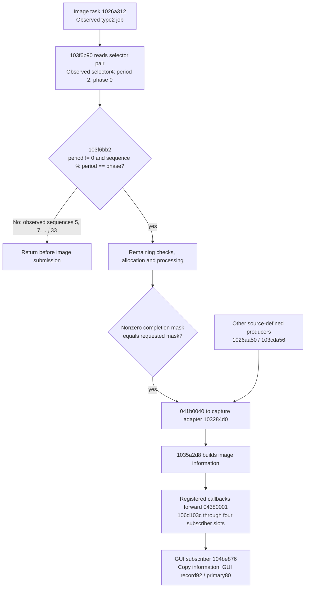
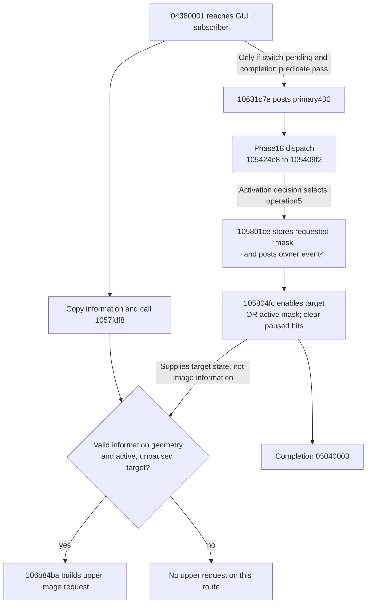

# Image information and display activation

The cold-neutral checkpoint reaches GUI drawing and display-layer programming,
but has no active display target or observed publication through the traced
image-information subscriber.
The image-task branch rejects the surviving sequence phase before image DMA.
An upstream task cancels the eligible phase because two computed-input caches
have never been published. The focused trace also finds the service callback
queue full of OnVd work; the needed state-transition callback is queued behind
that work or rejected. These are software boundaries, not a newly established
unsupported device contract. AF6's state9 request is a separate conditional route;
forcing it is not justified as a normal GUI prerequisite.

Addresses below are original C1.70 MAS CPU VA unless explicitly marked PA.
Source is the unchanged MAS payload at base10020000, inspected in IDA;
unrecognized Thumb wrappers were decoded without changing the database.
The [published admission summary](/evidence/imagerequest/admission.json)
contains the critical observations and omissions. Raw disassembly, argv,
snapshots and traces remain private and are not shipped with the handbook.

## Image-information admission

The branch labels are source conditions. Only the early-exit branch was
observed for the 15 selector4 jobs in the `cadence` window; the remaining
path has further checks and is not demonstrated by a statistics completion.
All code addresses in these diagrams are MAS VAs.

The early-exit result explains these jobs only. Other job types and other
publishers retain their separate branches; the period/phase pair is software
data and is not a hardware-ready register.

## Verified producers and conditions

| Edge | Source condition and effect |
|---|---|
| Image task `1026a312` | For the observed type2, read selector byte at `job[3]+14` through `103f6b90`, then require `103f6bb2(job[0]-1,pair)`. A false result returns without executing the remaining image path. Other types have explicit bypass branches. |
| Admission helper `103f6bb2` | `period != 0 && sequence % period == phase`. Getter `103f6b90` copies two words from `b18a9540 + selector*8`; these are software data, not MMIO readiness. |
| Image-information event | After the remaining checks, allocation and processing in `1026a312`, the assembled packet must have a nonzero completion mask equal to the requested mask before callback `b186488c` receives `041b0040`. Other producers include `1026aa50` and `103cda56`; this task is not the only publisher. |
| Capture service adapter `103284d0` | For `041b0040`, call `1035a2d8(packet[266])`. Its separately observed `04180203` case does not publish image information. |
| Information builder `1035a2d8` | Construct the information payload and call `b1866d88(04380001,payload)` if registered. |
| Callback registration | `106d1232(2)` calls `1061d442 -> 1034ff68` with Thumb callback `106d103d`. Wrapper `106d103c` forwards `04380001` to the four callback slots at `b25d874c` through `1061d3ca -> 103e4b08`. |
| GUI subscriber `104be876` | Registered by `104bf1aa -> 10551b62 -> 106d1334`. On `04380001`, `1058027e` copies464hex bytes and calls `1057fdf8`; copy another464hex bytes to `b201c038`, publish GUI record92 and primary event80. |
| Optional switch completion | In the same subscriber, only when `10631c2c()` reads nonzero `b181b470`, clear that word and call `10631c7e`. The latter posts primary400 only if the switch-completion predicate `10631c52` succeeds. An information notification alone does not guarantee activation. |

The packet paths above are original software producers. A processing-statistics
completion, or a raw0.bit6 interrupt, is not interchangeable with `041b0040`.

## Verified display activation path

An information event does not guarantee primary400 or activation. The diagram
shows the operation5 branch; policy operation0 and the separate owner-event80
activation handler remain distinct source paths described below. No activation
handler was observed in the focused window.

Primary400 dispatches `1053d0ec -> 106ddbfc(...,18) -> 105424e8 -> 105409f2`.
At its final activation decision, `10631f22()` true sends `104a94fe(5)`;
otherwise policy value3 from `104bde46()` sends operation0. Operation5 calls
`105801ce`, stores the requested target mask at `b181a574` and posts owner
event4. Handler `105804fc` enables the target through `10637aec`, ORs that
mask into active word `b181a56c`, clears its paused bits at `b181a570`, and
calls completion05040003. The owner's event80hex is another source-defined
activation handler; neither handler was observed in the focused window.

`1057fdf8` requires an active, unpaused target and valid information geometry
before it can reach `106b84ba`, which constructs the upper image request.
The active-mask test is therefore a concrete upstream condition on this route.

Mode entry `1053fe10:1053ffb0` also calls `1053fc46(10hex,0)`. This is a
selection refresh: `1063164a` compares old/new logical and raw selections.
In the observed logical0 state, command10hex changes neither, so returns0;
`1053fc46` skips the switch block and returns0. That block would send
operation4 and initiate switch synchronization/timer43. **Operation4 posts
owner event8, a disable operation, not the final enable.** Its absence does
not by itself explain why first activation has not occurred. The phase18
producer and image-information producer must be audited together; there is
no evidence permitting a forced initial enable mask.

## Observed cold-neutral boundary

`entry`, `producer`, `notify` and `cadence` each use the same cold-neutral
descriptor32, RNG0, healthy paced UART battery, held cold F4 and5 CPUs under
MTTCG. No extra key input or in-transaction debugger pause is used. Each
20-host-second window ends with a read-only snapshot. Trace filters differ;
an address outside a run's filter is not an observed absence. TCG chaining
also means entry observations are not exact call counts.

* `entry` observes GUI drawer10569c76 and layer writer1046d48a repeatedly.
  The latter's validator1047ed56 accepts the geometry and returns normally.
* Operations8,10,13 are observed. With property6433 empty, operation10 passes
  its policy checks and sends the original unpause; the historical ID68 skip
  does not explain this checkpoint. Operation5/phase18 and activation handlers
  are absent from their respective focused filters.
* Final active/requested-enable/paused words are all0. Target selection
  `b181b484=1` is present; pending switch words `b181b470/474/478` are0.
  Last pause/unpause masks `b181a57c/580=2` are not persistent pause state.
* At PA20145200, bank unit1 main control is13hex. Both port starts and layer
  enable words remain0. Valid layer parameter programming therefore does not
  prove an enabled scanout transaction; no rejected bank completion is found.
* `notify` and `cadence` observe image task1026a312, but no builder1035a2d8,
  forwarding wrapper106d103c or GUI subscriber104be876. The two observations
  of adapter103284d0 take the separate04180203 branch. Runtime callback
  pointers correctly contain106d103d,104be877 and103284d1 in their registries;
  missing registration is not the sampled problem. Both information buffers
  `b201c038` and `b1fa375c` remain entirely zero.
* In `cadence`, all15 observed admissions use selector4 and the pair `{2,0}`.
  The observed `job[0]-1` values are5,7,...,33. Each observed resume at
  1026a3e4 has return0, taking the early exit. This proves why these particular
  jobs do not publish; it does not prove all image producers have the same
  condition or establish a physical frame rate.

All six loader COPY ranges compare with the supplied descriptor32 input;
guard returns0 with version150, property6433 remains empty, QMP stays running,
and no uncovered access or battery-peer rejection appears. Sequential QMP
reads in `cadence` report1874/1873 accepted/completed readout requests and527
completed statistics jobs, with0 readout/statistics rejection and0 statistics
cancellation. There is still no display console. These are unchanged-firmware
functional-model receipts, not complete startup or physical-camera evidence.

The separate `keys` experiment retains the same data and held F4, then pulses
the remaining existing EX pad inputs through QMP. It observes no activation
or AF6 request and no console. It is not the no-extra-input baseline, and pad
identities are not established physical camera controls.

## Eligible jobs and the missing cache producer

The [phase and producer summary](/evidence/imagerequest/phase.json) extends the
earlier admission receipt with `cpu,nochain` observations. Disabling TCG chaining
does not reveal a hidden successful image-task admission. `103250f2` creates
both sequence parities; `103d0db0` assigns the same type2 task table to both.
The generic dispatcher `102994b4` skips remaining work after `job[1]` becomes
nonzero. Thus the queue does not initially select only the wrong parity.

The earlier step `102669aa` uses `103f6a60(selector4)` and the same `{2,0}`
cadence. For an eligible job it requires both `10272c9e(1)` and
`10272c9e(2)`. The first returns0 in all20 observed failed prerequisite checks;
the second is short-circuited. Store `10266a8c` sets `job[1]=1`. Opposite-phase
jobs bypass this work, survive to1026a312, then correctly fail its cadence test.
Changing the image phase would bypass the missing inputs, not repair their
producer.

| Source edge | Verified contract |
|---|---|
| `10272c9e -> 102de7f0` | Require both allocated storage at context+4 and a published flag at+20. Cache1/2 contexts are `b26c13b0/b26c13c8`. |
| `10272d20 -> 10272c7e -> 102de840` | Copy the supplied field, mark dirty and published under the original mutex. Cache1/2 lengths are10/11 bytes. |
| `10272d62` | Call the firmware calculation `10288560 -> 102d3264`, then publish cache1/2 through the source pointers stored at `b2725e00/b2725e04`. These are firmware-computed fields, not established opaque external records. Their complete input requirements remain a separate question. |
| `10273268` | Serialize a calculation request. A null callback computes inline; an asynchronous request wakes10272dc0 with bit2 and completes with041e000c. |
| `1022ef30 -> 10273268` | Synchronous producer after FECLCTRK completion041a000a, handled by1022f318. |
| `10235afe -> 10235e5c -> 10237d0e/10` | Submit FECLCTRK work when10235f3e accepts the root. Wrapper10237d0e is `MOV R1,R0`, falling through to10237d10. |

The read-only snapshot finds both caches allocated, with dirty/published flags0.
Caches3..6 are published, so this is not failure to initialize the entire cache
family. No10273268 or10272d62 entry is observed in their focused filters.

`102313ea` initially takes its bootstrap branch. Afterwards `b1887dc8=0`,
mode byte `b1887d72=0`, and metadata byte+10132=0 make it skip10235afe.
Another branch can setdc8 after exposure synchronization; `10230368` can also
set it after consuming a completed read queue entry. Neither justifies setting
the flag directly. Initial configuration10322886(0) constructs mode0 for
10232de6; zero is a software request, not a missing register readback.

## Callback backlog and observation limits

In the focused `join` window the skipped FE roots notify registered
`10327976(041a0002)`. It requests queued callback10326676 through10319d56.
That callback would call10323198(10,2); the original transition table maps
service state2/event10 to3. It is **not** observed executing. Registration and
the request are therefore present; consumption is the new boundary.

The queue at `b23ede14` holds60 records of92 bytes. Its final occupancy is60.
Of completed, matched enqueue observations, OnVd callback10325ff6 is accepted94
times and rejected442 times; callback10326676 is accepted twice and rejected31
times. `1022587c` returns0 on full, while10319d56 ignores that result and still
wakes the worker. The worker103191b2 has entered38 OnVd calls in this window.
The accepted transition requests can remain behind older work; the rejected
requests are not pending messages. Initial10232de6 returns in this trace, so
the backlog is not evidence of an indefinitely blocked initial configuration.

**Hypothesis:** the virtual input cadence and guest processing throughput can
prevent the service from catching up. The board's33333334ns input period is a
functional assumption. A separate100ms-period experiment empties the queue but
ends in service state10 with no image task or published cache1/2; a slower1s
attempt has no complete final snapshot. Neither validates a pacing repair.
Both temporary board changes were removed.

A separate sparse, chained trace with the default period also ends with an
empty queue, service state4 and CPU0 at vector10100008, without a console.
Runs with CPU logging disabled failed the old snapshot's non-null descriptor
precondition and are excluded from the successful checkpoint receipts.
These observations expose sensitivity to execution/observation conditions;
they do not prove the focused backlog is the only startup failure. QMP
`running`, or a live battery peer, does not prove healthy guest execution.

The next evidence must identify the outstanding OnVd call/wait and the first
state-transition consumption across a controlled execution window. A device
change must attach to an actual request/completion contract. Slowing input,
coalescing guest messages, filling caches, or injecting state3 is not an
accepted correction on this evidence.

## Additional first-enable producers

Phase18 is not the only source-defined enable route. Initial mode entry
1053fe10 can post primary8000 at10540502. `1053d0ec` maps that bit to phase17,
whose10540be2 handler can reach operation5 after its target/policy guards.
In the focused window the calculated mask is1, selected target is already1,
and1063192c returns0; the code bypasses the8000 post. No phase17 entry occurs.
This is an intentional no-change decision, not a failed hardware ACK.

A distinct direct route is primary4 -> phase5 ->105413d6. Its
`104bf2ee(ed)` result must be nonzero before10541578 reads property6433.
With an empty list and flag42 clear it then sends operation5 at105415a8.
The property-to-index record at MAS VA12449ff0 maps6433 to index `ed`; the lookup
uses its RAM table atb2bb1080. Property callbacks104be4ea/104be5fa map a
notification to this index, call104bd90e, then post primary4. `104bd90e`
requires the index enabled and not already pending;104bf2ee consumes the flag.
An empty property value alone therefore does not request an enable.

In `join`, phase5 executes repeatedly, but all99 observations at10541578
haveR4=0, bypassing this direct enable. Policy is not permanently0:
104be90a receives0410000b and writes1 to b181c99c. This rules out explaining
the entire window by the earlier policy0 observation. A further focused
`enable` window confirms the runtime6433 ->ed mapping, index-enabled byte1,
pending byte0, no104bd90e(ed), and no1035ed5c entry. That helper's clear-list
arm can write an empty6433 through1034ffe0; one source route is capseq worker
bit20000000 from103977f6's successful error-clear branch. It has its own
guards and is not established as a mandatory initial-startup request.
Which normal notification
or selection transition should perform **first** activation still requires a
runtime join; the source admits several routes, and none should be declared
the unique startup producer merely from its call graph.

## AF6 relationship and next evidence

The [AF6 producer audit](../devices/statistics/protocol.md#separate-software-image-request-condition)
establishes `103f27ba -> 10328ca6 -> 10323a7e`: service state9 and
property1053=1 guard the queued request that sets AF6=1. `10324f04` then sets
root[16] only while requested/produced counters differ. Root[8] separately
requires B0C=2. This window still has service state2, AF6=0 and B0C=0, with
neither AF6 API nor worker observed. Those gates explain that route's absence.
The normal information/display functions above have their own guards; they
do not test AF6 at the identified edges. A shared earlier dependency remains
possible, but no evidence establishes AF6/state9 as their required producer.

The eligible-job cancellation is now established; the earlier conjecture of
an unexplained parity selector is superseded by the cache/queue evidence above.
This audit adds no accepted hardware behavior. The existing statistics model
remains unchanged; its81-case native receipt is separate from these original
firmware observations and from the unsuccessful timing experiments.
