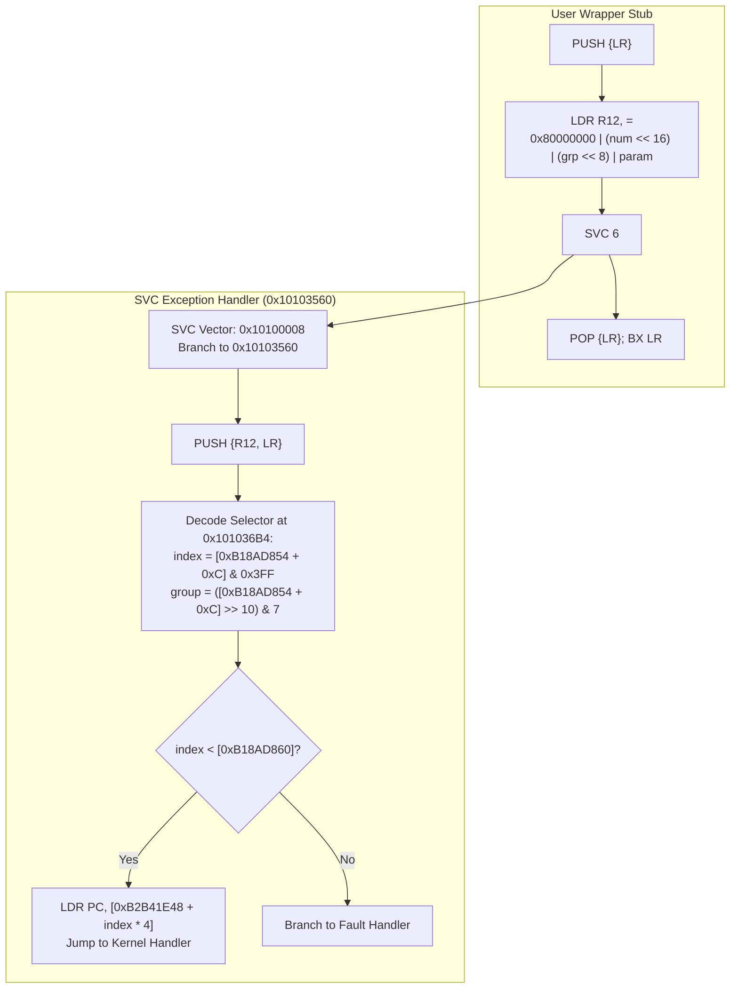

# MAS System Call (SVC) Dispatch Architecture

The camera RTOS provides an ARM Supervisor Call (`SVC 6`) gateway mechanism allowing user-space tasks to invoke kernel services through an indexed handler vector table.

## System Call Selector Format

Each system call wrapper encodes its service identity in register `R12`:

$$\text{Selector} = \text{0x80000000} \ | \ (\text{number} \ll 16) \ | \ (\text{group} \ll 8) \ | \ \text{parameter}$$

- **Bit 31**: High bit asserted (`0x80000000`), identifying a kernel system call.
- **Bits [23:16]**: System call number (`0x01` to `0x38`).
- **Bits [10:8]**: Service group classification (`0x0` to `0x3`).
- **Bits [7:0]**: Parameter byte.

## Kernel Vector Table (`0xB2B41E48`)

The dispatcher uses `index * 4` as an offset into the master kernel function pointer table located at `0xB2B41E48`:

| Number | Group | Selector | Wrapper Literal | SVC Site | Description |
|---|---|---|---|---|---|
| `0x01` | `0x01` | `0x80010100` | `0x101044F8` | `0x101044FC` | Task creation & initialization |
| `0x02` | `0x01` | `0x80020100` | `0x10104564` | `0x10104568` | Task sleep / delay |
| `0x03` | `0x02` | `0x80030200` | `0x10104960` | `0x10104964` | Semaphore wait |
| `0x04` | `0x00` | `0x80040000` | `0x10104600` | `0x10104604` | Event flag set |
| `0x06` | `0x01` | `0x80060100` | `0x101049D4` | `0x101049D8` | Event flag wait |
| `0x08` | `0x00` | `0x80080000` | `0x101045D8` | `0x101045DC` | Event flag clear |
| `0x09` | `0x02` | `0x80090200` | `0x10104364` | `0x10104368` | Mutex lock |
| `0x0A` | `0x02` | `0x800A0200` | `0x1010438C` | `0x10104390` | Mutex unlock |
| `0x17` | `0x02` | `0x80170200` | `0x101047DC` | `0x101047E0` | Interrupt enable / disable |
| `0x1C` | `0x01` | `0x801C0100` | `0x10104A6C` | `0x10104A70` | Memory block allocate |
| `0x24` | `0x02` | `0x80240200` | `0x101048A0` | `0x101048A4` | Memory block free |
| `0x29` | `0x02` | `0x80290200` | `0x10104704` | `0x10104708` | Timer callback register |
