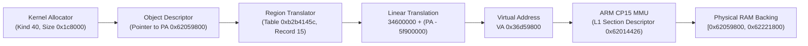

# Kind40 storage and address translation architecture

This specification details the dynamic memory allocation kind 40 (decimal), the kernel region translation table, and physical RAM backing for GUI staging in the Nikon Z7II C1.70 MAS firmware.

## Architecture and translation flow

The GUI initializer at MAS Thumb VA `0x10238314` requests dynamic memory allocation kind 40 (`0x1c8000` bytes, 1,824 KiB) through kernel allocator `0x1030d96e(0, 40, 0x1c8000)`.

## Region translation parameters

The translation table rooted at `0xb2b4145c` matches record 15 at offset `0xb2b41510`:

| Translation Parameter | Record Value | Description |
|---|---|---|
| Physical Class Base | `0x5f900000` | Start of physical memory window |
| Conversion Type | `1` | Direct linear address offset translation |
| Logical Class Base | `0x34600000` | Start of virtual address window |
| Bound / Next Class | `0x62700000` | Upper limit of matched translation class |

### Translation equation
$$\text{VA} = \text{Logical Base} + (\text{PA} - \text{Physical Base})$$
$$\text{VA} = 0x34600000 + (0x62059800 - 0x5f900000) = 0x36d59800$$

## ARM MMU translation verification

The ARM Cortex-A7 translation table entries corroborate this mapping:
- **Secure TTBR0 Base**: `0xb2b74000`
- **Translation Control Register (`TTBCR`)**: `0x00000000`
- **L1 Section Descriptor for VA `0x36d59800`**: `0x62014426`
- **Derived Physical Address**: Section base `0x62000000` OR-ed with index `0x00059800` yields `PA 0x62059800`.

## Memory model contract

1. **Physical Storage Backing**: The machine maps exact RAM at `[0x62059800, 0x62221800)` with length `0x1c8000`. Memory defaults to zero on reset and persists across machine reboots.
2. **No False Bus Mirrors**: The emulator provisions memory at the physical address space; it does not install virtual mirrors at `VA 0x36d59800`. The ARM TCG MMU handles VA-to-PA translation natively.
3. **Subsequent Bootstrap Horizon**: Following memory zeroing by routine `0x10361034`, firmware proceeds to initialize source streams at `PA 0x50560000` (row stream buffers).
