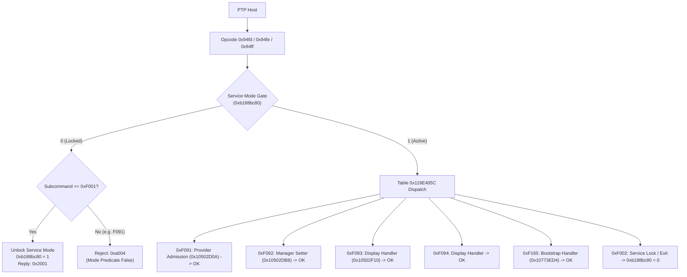

# Physical camera PTP and service interface

The physical camera baseline provides ground truth for Nikon Z7II (C1.60/C1.70)
USB transport, device property behaviors, streaming preview framing, and the
undocumented `0x94fd` service dispatch path modeled in
[PTP command boundary](ptp.md).

All observations below were gathered from an attached physical Nikon Z 7II
without intrusive disassembly or firmware modification.

## Physical test baseline

| Parameter | Observed value |
|---|---|
| Hardware model | `NIKON DSC Z 7_2` |
| USB Vendor / Product ID | `0x04B0` / `0x044B` |
| Firmware version | `V1.60` (compatible generation with target `C1.70`) |
| Serial number | `00000000000000000000000008027437` |
| USB interface | Class `0x06` (Still Imaging), SubClass `0x01`, Protocol `0x01` (PTP) |
| Endpoint configuration | EP `0x02` (Bulk OUT, 512 B), EP `0x81` (Bulk IN, 512 B), EP `0x83` (Interrupt IN, 8 B) |

The complete capability and property capture is archived in
[`ptp_profile.json`](/evidence/physical/ptp_profile.json).

## PTP capability and storage mapping

Standard `GetDeviceInfo` (`0x1001`) reports:
* **Standard version**: PTP 1.00 with vendor extension `0xFFFFFFFF` (version 1.10, `Microsoft.com/DeviceServices: 1.0`);
* **Operations**: 19 standard PTP operations plus 75 advertised vendor operations (`0x90C0..0x90CF`, `0x9201..0x920F`, `0x9400..0x945A`, `0x9520..0x9535`);
* **Events**: 27 asynchronous events on interrupt endpoint `0x83`;
* **Properties**: 21 exposed device properties covering exposure mode, shutter speed, aperture, ISO, white balance, battery level, and client handshake status.

`GetStorageIDs` (`0x1004`) and `GetStorageInfo` (`0x1005`) resolve the dual media slots:

| Storage ID | Slot | Physical media | File system | Capacity | Free space |
|---|---|---|---|---|---|
| `0x00010001` | Slot 1 | CFexpress Type B (512 GB) | DCF / Removable RAM | 476.88 GB | 452.97 GB |
| `0x00020000` | Slot 2 | SD slot (unpopulated) | Unmounted | 0.00 GB | 0.00 GB |

## Live view preview stream and framing header

Live view operation sequence:
1. `0x9201` (`StartLiveView`): initiates the camera live view stream;
2. `0x9203` (`GetLiveViewImg`): requests the next frame from the camera buffer;
3. `0x9202` (`EndLiveView`): stops live view and returns optical/sensor state to idle.

Each frame returned by `0x9203` consists of a 384-byte header followed
immediately by a complete JPEG stream (`0xFFD8..0xFFD9`). The header fields use
big-endian (network) byte order:

```text
+0x00: u32 header_payload_bytes (0x00000178 = 376 bytes; padded to 384 bytes)
+0x04: u32 jpeg_stream_bytes    (e.g. 0x00004118 = 16,664 bytes)
+0x08: u16 frame_width          (0x0280 = 640)
+0x0A: u16 frame_height         (0x01A8 = 424)
+0x0C: u16 sensor_crop_width    (0x1520 = 5,408)
+0x0E: u16 sensor_crop_height   (0x0E10 = 3,600)
+0x10: u16 full_sensor_width    (0x1520 = 5,408)
+0x12: u16 full_sensor_height   (0x0E10 = 3,600)
+0x14: u16 center_x             (0x0A90 = 2,704 = 5,408 / 2)
+0x16: u16 center_y             (0x0708 = 1,800 = 3,600 / 2)
+0x18: u16 focus_box_width      (0x0114 = 276)
+0x1A: u16 focus_box_height     (0x0132 = 306)
+0x1C: u16 focus_target_x       (0x0A90 = 2,704)
+0x1E: u16 focus_target_y       (0x0708 = 1,800)
+0x20..+0x17F: AF tracking, face/eye boxes, histogram bins, and timestamp
```


### Relevance to QEMU display pipeline

The header establishes the exact coordinate transformation used by MAS
display routines:
* The native sensor coordinate space is `5408 × 3600` with optical center `(2704, 1800)`;
* The preview scaler downsamples this raster to `640 × 424` for USB delivery, while
  the camera's internal display queue formats `1024 × 682` surfaces for panel scanout;
* Focus indicator dimensions and coordinates map linearly onto the sensor space.

## Undocumented service mode operations (0x94fd..0x94ff)

Opcodes `0x94fd`, `0x94fe`, and `0x94ff` are not advertised in `GetDeviceInfo`,
but are dispatched by the MAS table at VA `0x119E1E74` as described in
[PTP command boundary](ptp.md).

Physical testing verified both the service gate predicate and individual service keys:



### Observed response matrix

| Opcode | Subcommand | Mode gate state | Physical response | Params | Meaning |
|---|---|---|---|---|---|
| `0x94FD` | `0xF001` | Locked (`0`) | `0x2001` (OK) | `0x2001` | Unlock service mode; sets gate active (`0xb188bc80 = 1`) |
| `0x94FD` | `0xF001` | Active (`1`) | `0x2001` (OK) | `0x201E` | Already unlocked / session active |
| `0x94FD` | `0xF091` | Locked (`0`) | `0xA004` (Error) | `0x0000` | Rejected by mode predicate (matches QEMU trace) |
| `0x94FD` | `0xF091` | Active (`1`) | `0x2001` (OK) | `0x2001` | Provider admission dispatched (514 ms latency) |
| `0x94FD` | `0xF092` | Active (`1`) | `0x2001` (OK) | `0x2001` | Manager setter executed |
| `0x94FD` | `0xF093` | Active (`1`) | `0x2001` (OK) | `0x2001` | Display service executed |
| `0x94FD` | `0xF094` | Active (`1`) | `0x2001` (OK) | `0x2001` | Display service executed |
| `0x94FD` | `0xF165` | Active (`1`) | `0x2001` (OK) | `0x2001` | Bootstrap service executed |
| `0x94FD` | `0xF002` | Active (`1`) | `0x2001` (OK) | `0x2001` | Lock service mode; resets gate to `0` |

This directly confirms the MAS firmware analysis in [`docs/runtime/ptp.md`](ptp.md):
* The outer envelope operations `0x94FD..0x94FF` route 28-byte service rows;
* Subcommand `0xF001` is the single bypass past the mode predicate;
* Subcommand `0xF091` requires service state and enters the display-service broadcast.

## Full vendor device property enumeration (0xD016..0xD314)

While standard `GetDeviceInfo` reports only 21 general properties, vendor opcode
`0x90CA` publishes the complete inventory of **259 Nikon vendor device properties**:

* Raw inventory binary: [`payload_90ca.bin`](/evidence/physical/payload_90ca.bin) (522 bytes, 259 `u16` codes);
* Range: `0xD016` to `0xD314`;
* Full dump: [`vendor_properties_259.json`](/evidence/physical/vendor_properties_259.json), mapping data types, `GetSet` access flags, default values, and active values;
* Detailed technical registry: [Nikon Vendor Device Properties Inventory](ptp_vendor_properties.md), mapping every property to its hardware/firmware subsystem, data type, access rights, and menu function.

## Exhaustive F0 service table mapping (0xF000..0xF200)

A systematic scan of the `0xF000..0xF200` range through `0x94FD` in unlocked state
discovered **490 active service table entries** (matching the MAS firmware table
at VA `0x119E405C`):

* **Success responses**: 111 subcommands return `0x2001` (OK) directly with zero or default arguments;
* **Data-returning subcommands**: 11 subcommands stream structured binary responses:
  * `0xF006`: 4-byte engine status word;
  * `0xF04C`: 60-byte task and clock telemetry record;
  * `0xF050` / `0xF051` / `0xF052`: 28, 28, and 80-byte component identification tables containing ASCII `'01000160'`;
  * `0xF06E`: 296-byte body parameter record;
  * `0xF113` / `0xF114`: 8 and 12-byte sensor/timing timestamps;
  * `0xF162` / `0xF163`: 12-byte status and 1402-byte bootstrap scratch block;
  * `0xF1F9`: 8-byte subsystem status.

All 11 payload captures are archived under [`service_payloads/`](/evidence/physical/service_payloads/manifest.json).

## Receipts and verification tools

* Probe client: `tools/ptp/ptp_client.py`
* Automated profile scanner: `tools/ptp/probe_full.py`
* Vendor opcode scanner: `tools/ptp/scan_vendor_ops.py`
* F0 service table scanner: `tools/ptp/scan_service_table.py`
* Vendor property dumper: `tools/ptp/dump_vendor_properties.py`
* Service payload dumper: `tools/ptp/dump_service_payloads.py`
* Complete capability JSON: [ptp_profile.json](/evidence/physical/ptp_profile.json)
* Vendor properties database: [vendor_properties_259.json](/evidence/physical/vendor_properties_259.json)
* F0 service table scan results: [service_keys_scan.json](/evidence/physical/service_keys_scan.json)
* Binary live view header: [liveview_header.bin](/evidence/physical/liveview_header.bin)
* Live view sample image: [liveview_sample.jpg](/evidence/physical/liveview_sample.jpg)
