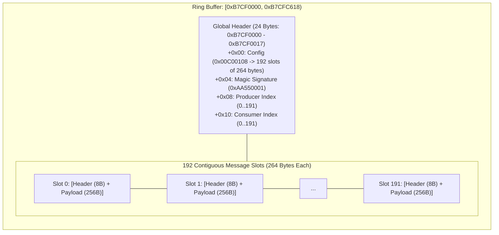

# Shared Inter-Processor Sending Ring Buffer

The camera OS maintains a 50,712-byte (`0xC618`) circular message ring buffer at physical address `0xB7CF0000` within Class 22 storage, enabling asynchronous message packet exchange between the primary MAS CPU and auxiliary coprocessors.

## Ring Geometry and Header Layout

$$\text{Total Length} = 0x18 + (192 \times 0x108) = 0x18 + 0xC600 = 0xC618 \quad (50,712 \text{ bytes})$$

| Offset | Field Name | Width | Initial Value | Description |
|---|---|---|---|---|
| `+0x00` | `RING_CONFIG` | 32-bit | `0x00C00108` | Encodes slot count (`0xC0` = 192 slots) and slot stride (`0x108` = 264 bytes). |
| `+0x04` | `RING_MAGIC` | 32-bit | `0xAA550001` | Protocol synchronization header magic. |
| `+0x08` | `RING_PROD_IDX`| 32-bit | `0x00000000` | Head write index advanced by producer (modulo 192). |
| `+0x0C` | `RING_RESERVED0`| 32-bit | `0x00000000` | Reserved. |
| `+0x10` | `RING_CONS_IDX`| 32-bit | `0x00000000` | Tail read index advanced by consumer (modulo 192). |
| `+0x14` | `RING_RESERVED1`| 32-bit | `0x00000000` | Reserved. |

## Slot Structure & Protocol Handshake

Each message slot spans 264 bytes (`0x108`):
- **Slot Header (8 bytes)**: Contains message length, command ID, transaction token, and status flags.
- **Payload Body (256 bytes)**: Structured parameter payload or communication buffer.
- **Full Capacity Rule**: The producer leaves at least one slot empty, allowing up to 191 in-flight message envelopes.
- **Lifecycle**: Firmware writes message payload, advances the producer index at `+0x08`, and triggers downstream peer notification via the Bridge 2013 controller or GIC software interrupts.
