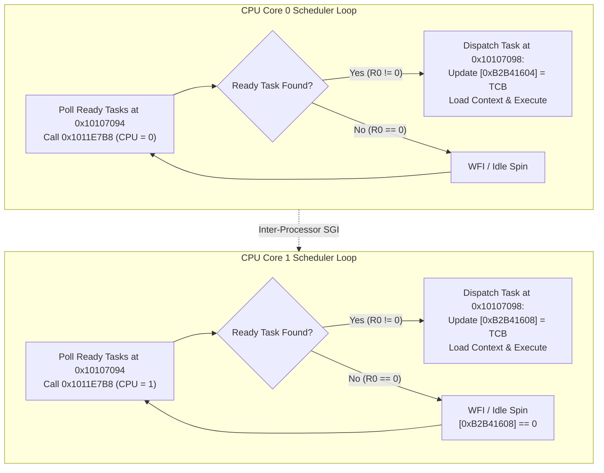

# Multi-Core RTOS Task Scheduler & Affinity

The camera RTOS implements symmetric multiprocessing (SMP) task scheduling across the dual Cortex-A7 cores, employing per-core ready queues, task control blocks (`TCB`), and explicit CPU affinity.

## Per-Core Scheduler Cells

The kernel maintains active scheduler state in fixed RAM cells:

| Physical Address | Cell Name | Core 0 Value | Core 1 Value | Description |
|---|---|---|---|---|
| `0xB2B41604` | `SCHED_CUR_TCB_C0` | Active TCB pointer | `0x00000000` | Current executing task control block for Core 0 |
| `0xB2B41608` | `SCHED_CUR_TCB_C1` | `0x00000000` | Active TCB pointer | Current executing task control block for Core 1 |
| `0xB2B42258` | `SCHED_READY_MASK` | Ready bitmap | Ready bitmap | Per-core ready queue status bitmap |
| `0xB2B415F4` | `SCHED_PREV_TCB` | Previous TCB | Previous TCB | Context switch bookkeeping |

## Scheduling Lifecycle & Affinity Rules

1. **Initial Bootstrap Dispatch**:
   - The primary initialization tasks (Task `0x01000001` at `0x10103BC8` and Task `0x01000026` at `0xB20A1710`) are created with Core 0 affinity.
   - Core 0 dispatches and runs these tasks while Core 1 remains parked in the idle scheduler loop (`0x10107094`) with `[0xB2B41608] == 0`.
2. **Core 1 Handoff**:
   - Core 1 only transitions out of idle when Core 0 assigns a task explicitly affined to Core 1 or triggers a GIC Software Generated Interrupt (SGI).
   - Core 1 unblocks from `WFI`, reads its non-zero task pointer from `0x1011E7B8`, and jumps to `0x10107098` to restore the task context.
