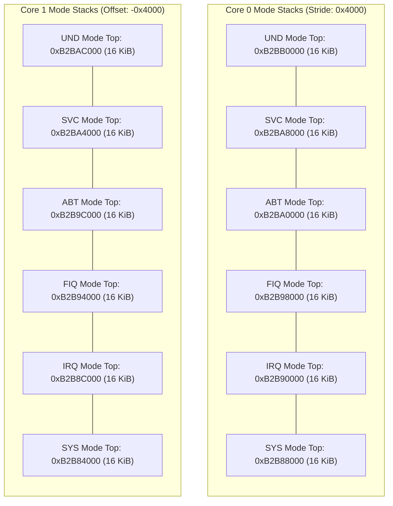

# Dual-Core ARM Exception Mode Stacks

The Nikon EXPEED architecture provisions dedicated 16 KiB physical stack spaces for each of the six ARM Cortex-A7 execution modes, banked independently across CPU Core 0 and CPU Core 1.

## Stack Layout & Top Calculations

Each mode stack provides 16 KiB (`0x4000` bytes) of dedicated descending stack memory:

$$\text{Stack Top}(\text{mode}, \text{core}) = \text{Base Top}(\text{mode}) - (\text{core} \times 0x4000)$$

| Execution Mode | Base Top (CPU 0) | Base Top (CPU 1) | Size | Primary Usage |
|---|---|---|---|---|
| **Undefined (`UND`)** | `0xB2BB0000` | `0xB2BAC000` | 16 KiB | Undefined instruction traps |
| **Supervisor (`SVC`)** | `0xB2BA8000` | `0xB2BA4000` | 16 KiB | System call wrappers, OS kernel calls |
| **Abort (`ABT`)** | `0xB2BA0000` | `0xB2B9C000` | 16 KiB | Prefetch and Data Abort exception handlers |
| **FIQ (`FIQ`)** | `0xB2B98000` | `0xB2B94000` | 16 KiB | Fast interrupt service routines |
| **IRQ (`IRQ`)** | `0xB2B90000` | `0xB2B8C000` | 16 KiB | Peripheral interrupt dispatching & ISR entry |
| **System (`SYS`)** | `0xB2B88000` | `0xB2B84000` | 16 KiB | Initial bootstrap task execution stack |

## Inter-Core Isolation & Safety

1. **SMP Stride**: The 16 KiB per-core offset prevents stack corruption when both cores handle simultaneous interrupts (e.g. Core 0 processing GIC SPI while Core 1 handles SGI).
2. **Context Preservation**: During hardware interrupt entry, the CPU switches to IRQ mode, saves context into its private IRQ stack, acknowledges GIC IAR, and transitions to SVC mode for high-level RTOS service execution.
