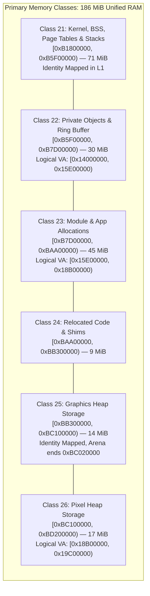

# Complete Software Storage Architecture

The Nikon Z7II system provisions six primary DDR storage classes (Classes 21 through 26), totaling 186 MiB of unified physical RAM shared across CPUs, DMA controllers, and graphics rasterization hardware.

## Storage Classes Specification

| Class ID | Physical Range | Size | Logical VA Translation | Primary Subsystem Usage |
|---|---|---:|---|---|
| **Class 21** | `[0xB1800000, 0xB5F00000)` | 71 MiB | Identity (`0xB1800000`) | Kernel image copies, BSS variables, L1/L2 translation tables, and exception mode stacks |
| **Class 22** | `[0xB5F00000, 0xB7D00000)` | 30 MiB | `[0x14000000, 0x15E00000)` | RTOS private object pools, inter-processor message rings |
| **Class 23** | `[0xB7D00000, 0xBAA00000)` | 45 MiB | `[0x15E00000, 0x18B00000)` | Dynamic application allocations, staging arenas |
| **Class 24** | `[0xBAA00000, 0xBB300000)` | 9 MiB | Relocation Base | Dynamic relocated code segments |
| **Class 25** | `[0xBB300000, 0xBC100000)` | 14 MiB | Identity (`0xBB300000`) | Graphics rasterizer heap (active arena ends at `0xBC020000`) |
| **Class 26** | `[0xBC100000, 0xBD200000)` | 17 MiB | `[0x18B00000, 0x19C00000)` | Pixel buffer pool (active arena ends at `0xBD1E0000`) |

## Auxiliary Memory Regions

- **Kind 40 Dynamic Allocation**: Located at physical `[0x62059800, 0x62221800)` (1.78 MiB), mapped through region table selector 40.
- **Resource 57 GUI Slots**: Firmware publishes slot descriptors in cell `0xB181D384` (`0xBEC5F200`, length `0x4B0000`).

## RTOS Task Synchronization & Namespaces

The camera RTOS coordinates execution using event flag objects:
- **Event Flag `0x01000003`**: Manages task synchronization for worker tasks 4 and 5 (waiting on bit mask `0x10` and `0x02`).
- **Event Flag `0x01000015`**: Coordinator flag managing initialization sequencing for task `0x010000B9`.
- **Event Flag `F0` (ID `0x01000088`)**: Synchronizes peripheral gate stop lifecycle (bit 2 unblocks the coordinator upon completion of the Control2010 20 µs drain).
