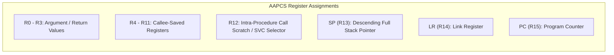

# ARM Execution Environment & Calling Conventions

The Nikon Z7II guest execution environment conforms to the ARM Architecture Procedure Call Standard (AAPCS), governing register usage, stack frame layout, and exception transitions.

## Register Usage Conventions

- **R0 - R3**: Argument registers for function calls. Return values are returned in `R0` (32-bit scalar) or `R0:R1` (64-bit value).
- **R4 - R11**: Callee-saved general-purpose registers. Functions preserve these registers across execution frames.
- **R12 (IP)**: Intra-procedure scratchpad register. Used by system call stubs (`SVC 6`) to pass the packed 32-bit service selector into the kernel dispatcher.
- **R13 (SP)**: Full descending stack pointer. Maintained at 8-byte alignment at public function boundaries per AAPCS specifications.
- **R14 (LR)**: Link register, holding the return address upon subroutine calls (`BL`/`BLX`) and exception transitions.

## Debugger Frame Unwinding
- Debuggers connecting via the QEMU GDB stub must configure ABI emulation explicitly to **AAPCS** rather than legacy APCS. Legacy APCS prologue scanning attempts speculative heuristic reads through `R11 - 8`, which causes target memory faults when examining stripped firmware binaries without ELF symbols.
