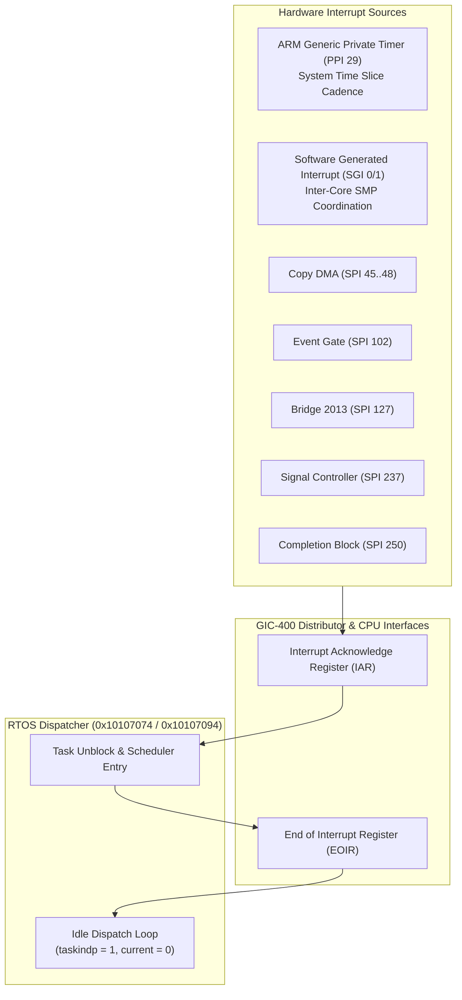

# GIC Interrupt Delivery & Software Wait Validation

During RTOS runtime, worker tasks transition between active execution and blocked wait states based on hardware peripheral interrupts and kernel timer ticks.

## CPU and GIC Architecture Contracts

1. **Dual Cortex-A7 Core Affinity**:
   - Upstream ARM TCG models dual-cluster affinity (`0.0` for Core 0, `0.1` for Core 1) with `V7MP` flags enabled.
   - GIC private peripheral interrupts (PPI) are banked per CPU core at base `256 - 32 + (cpu * 32)`.
2. **Generic Timer (PPI 29)**:
   - Delivers regular architectural timer interrupts driving the kernel's round-robin scheduling cadence.
   - Core 0 services PPI 29, updates kernel tick counters, and acknowledges via GIC `EOIR29`.
3. **Dispatcher Idle State (`into_dsp` / `chk_restore`)**:
   - When no tasks are currently runnable on a core, the core enters the dispatcher loop at `0x10107094` (`0x10107074` on Core 0).
   - In this state, the kernel sets `taskindp = 1` and `current_tcb = 0`. This is the normal idle condition awaiting peripheral interrupt unblock or an inter-processor SGI.
