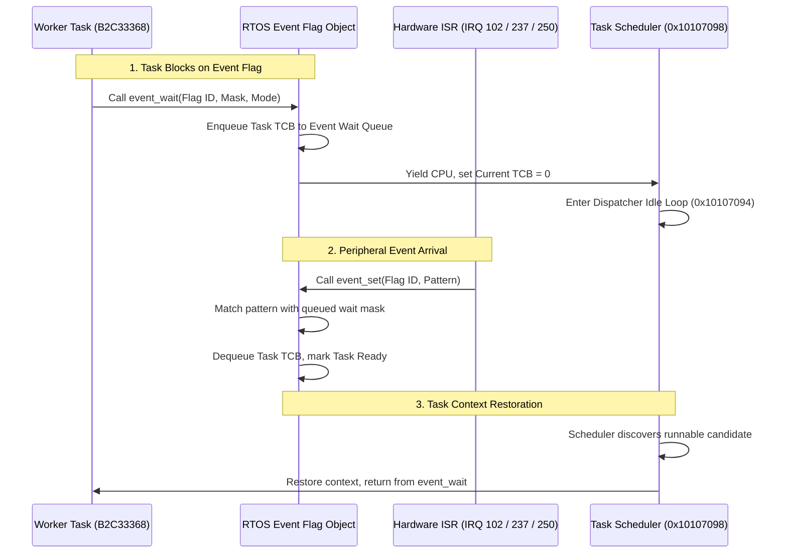

# Event Flag Wait & Wakeup Lifecycle

Tasks in the camera RTOS synchronize asynchronously via kernel event flag objects, transitioning from blocked wait queues to active execution upon peripheral interrupt service completion.

## Event Synchronization Protocols

1. **Wait Specifications**:
   - Tasks register a wait pattern and mode (e.g. `mode 1` for ANY bit match, `mode 0` for ALL bits match).
   - If the requested pattern is not currently set on the target event flag object, the calling task is added to the object's blocked wait queue, and control yields to the scheduler.
2. **Asynchronous Pattern Setting**:
   - Hardware ISRs acknowledge physical device interrupts (e.g., Control2010 gate stop confirmation, Signal controller edge detection), invoke registered C callbacks, and call the kernel's `event_set` API.
   - The kernel matches the newly asserted pattern against active waiters, moves satisfied tasks to the ready queue, and triggers scheduling dispatch.
