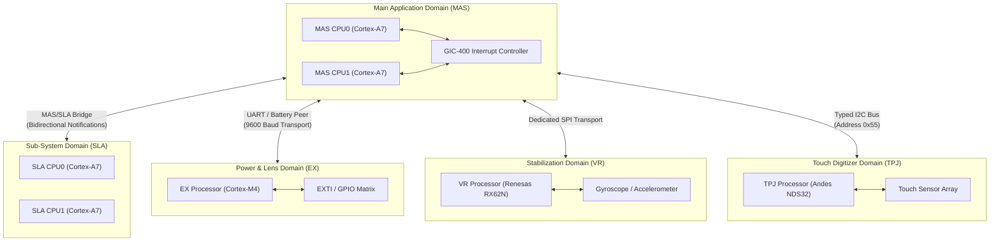

# Five-component input and multi-domain architecture

The Nikon Z7II camera system comprises five distinct firmware components and processor execution domains integrated into a unified hardware bundle.

## System domain architecture

## Component specifications

| Component | Target Architecture | Memory Mapping | Physical / Functional Responsibility |
|---|---|---|---|
| **`MAS`** | Dual-core ARM Cortex-A7 | VMA `0x10020000`, PA `0x10000000..0x62000000` | Main application RTOS, user interface rendering, graphics composite engine, and storage management |
| **`SLA`** | Dual-core ARM Cortex-A7 | VMA `0x10020000`, private peripheral space | Optical sensor timing, CMOS readout DMA synchronization, and lens communication |
| **`EX`** | ARM Cortex-M4 | Base `0x08000000`, Vector `0x08000004` | Power sequencing, hardware RNG, battery handshake/authentication, external button sampling |
| **`VR`** | Renesas RX62N (RXv2 with EXTB) | Flash `0xfff80000`, Reset `0xfffffffc` | In-body image stabilization (IBIS), voice-coil motor driving, angular velocity tracking |
| **`TPJ`** | Andes NDS32 V3 | Internal SRAM `0x00000000`, IO apertures | Capacitive touch screen digitizer, touch coordinate filtering, and gesture reporting |

## Container structure and intake rules

1. **Decoded Five-Component Container**: Input to the emulator is a verified container packaging all five extracted payload records.
2. **Boundary Validation**: The bundle loader validates cryptographic magic headers, entry bounds, and component lengths before realizing machine devices.
3. **No Cross-Domain Memory Shortcuts**: Subsystem communication is mediated strictly by modeled hardware peripherals (Bridges, UART char backends, I2C engines, and SPI buses) rather than host memory copies.
