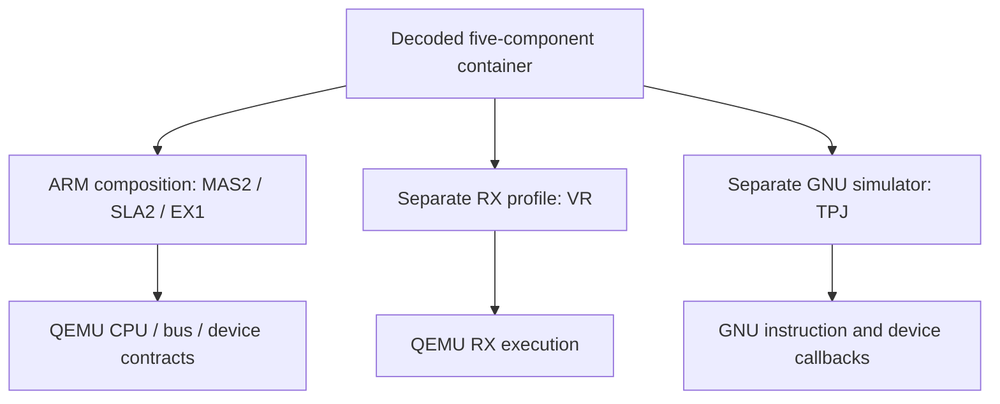

# Five-component input and execution domains

The composed ARM profile runs MAS2,SLA2 and EX1. VR has a separate QEMU RX
profile; TPJ uses the separate GNU NDS32 simulator. Parsing five component
records, executing their domains and completing a joint boot are separate
results. See [architecture](../architecture.md) and the
[current frontier](../validation/frontier.md).

## Container contract

The following qualifies the loader and execution domains. Later
domain receipts supersede historical pending-work descriptions.

hw/nikon/components/bundle.c reads the extracted decoded-container.bin, after
removing its32-byte external wrapper. The container contains five directory
entries, per-component trailing CRCs, a whole-container CRC and padding.
It is neither concatenated file paths nor an original XOR update. Format
evidence comes from Nightglass src/nightglass/container.py and the C1.70 sample
registration. Extraction prepares input; it does not execute QEMU or its tests.

The parser validates the whole container before exposing five immutable
GBytes views: actual names/order, continuous source intervals, reserved fields,
CRC-16/XMODEM per component and whole-container CRC. Tail CRCs are not executable
bytes. VR record0 and all six-byte prefixes remain in its component input.
Lengths follow the directory, not fixed original lengths imposed on custom
firmware. Other bodies/profiles need independent evidence.

nikon_vr_body additionally returns contiguous256-byte bodies for records1..N
and the complete262-byte record0 separately. It verifies0401 prefixes,
continuous32-bit addresses, truncation and overflow. Conversion neither writes
flash nor boots a CPU or generates a peer ACK; it does not prove update success.

| Domain | Existing execution mechanism | Loader/connection boundary |
|---|---|---|
| MAS outer/inner |Upstream ARM TCG/GIC/architectural timers |Machine executes outer; guest must request inner copy/release; no host-prefilled inner RAM |
| SLA |Upstream ARM TCG,isolated address space |Same numerical ROM addresses as MAS contain different bytes; preserve independent CPU/machine views |
| EX |Upstream ARMv7M/NVIC/SysTick |Guest consumes original vectors/copy/unpack/clear; concrete CPU/clock/MMIO are declared software-bound profiles |
| VR |Upstream RX TCG/ICU/timers |Load from original records/source entry; do not borrow RX62N flash size/peripheral base/exception trampoline |
| TPJ |Pinned GNU NDS32 simulator |Upstream QEMU has no NDS32 target; [system](system.md) documents runner,IRQ,inputs and receipts, separately from Andes V5 RISC-V |

## VR loaded profile and transport

machines/vr.c creates nikonvr from original VR body records, mapping the merged
destinations of13 COPY and11 ZERO entries. Guest software copies/clears them;
host code does not prefill application,INTB or task objects. Original
fff00010 PUSHM depends on caller R0. Without the external loader, this profile
explicitly assumes caller-SP2000 and a4KiB virtual stack. Entry/ROM mappings
are recovered software addresses, not physical reset evidence.

Atfff00027 the original bootstrap uses MVTC r14,EXTB. Upstream RXv1 decodes
MVTC/MVFC but drops control register13. The explicit has-extb extension
retains that register, resets to upstreamffffff80 and uses actual EXTB for
exception dispatch. RX62N leaves it disabled; nikonvr enables it. This adds a
control-register capability, not complete RXv2 or a measured Nikon chip.

The application/bootstrap instruction-family inventory found ordinary
arithmetic,control,string and bit operations in the pinned translator, with
EXTB the identified addition. Encoding,memory,exception,timing and execution
still require original comparison. Original VR accesses80020 system config,
8c000 ports andc1200/c1280 SPI; these are not the RX62N board layout.
Missing peripherals and the externalfffc8000 interface must fail naturally,
not receive invented ready/ACK.

qemu-system-arm and qemu-system-rx are separate targets. Connections must use
actual chardev/SSI/I2C transactions and recovered protocols, with explicit
cross-process virtual-time/pause/input ordering; no fake foreign-ISA CPU is
inserted into the ARM process.

Static MAS VR transport uses SPI4 at2c0a0400,two DMAs,two buffers,op18 and
a268-byte message containing all262 bytes of a record. Prefixf7000801 is
followed by tail00 and a negative-sum checksum. Record advance requires a
real first reply byte2. Source contracts vr-transport-contract.md and
vr-record-loader.md do not authorize synthetic ACKs. TPJ/EX/VR backends must
follow their original consumers. The three-word IPUD external frame is a
functional transport API, not a proven physical interconnect.

## Evidence and validation scope

Native tests cover all five views,CRC known answer123456789→31c3,directory,
range,CRC,padding and every truncation,plus VR record0/body order/discontinuity.
Their original source-author checkpoint assigned native build/execution to
the integration owner and did not label unrun tests passed. Complete input
does not establish CPU execution or GUI.

Primary references: [QEMU RX](https://www.qemu.org/docs/master/system/target-rx.html),
[QEMU targets](https://www.qemu.org/docs/master/about/emulation.html),
[original Andes GNU submission](https://sourceware.org/pipermail/gdb-patches/2013-July/104886.html),
[Andes SDK target list](https://github.com/andestech/nds-gnu-toolchain).
The actual API baseline is QEMU4fc49f46dc95d4a27de2509e7fceb2931e91faeb.
[Renesas RXv2 vectors/reset](https://tool-support.renesas.com/autoupdate/support/onlinehelp/ja-JP/csp/V8.07.00/CS%2B.chm/Coding-RI600V4.chm/Output/SYSTEM.html)
supports the EXTB comparison. Original table/input provenance is Nightglass
fdbe3f3ed8c6523bb85885920c049fd92c2ae130. Factory assembly and firmware bytes
are not redistributed with this handbook.
