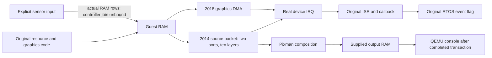

# GUI and image data path

The display lane now implements guest-buffer image processing and console
publication in the existing `banks.c`, in addition to the independently
implemented `transfer.c` graphics DMA. These paths, the CMOS transport,
graphics completion and scanout are implementation bases for a complete finite
deterministic pipeline, not reasons to wait for exact Bayer, GPU or camera
evidence. A console exists only after a complete successful data transaction.
A synthetic image fixture is not a receipt of the original GUI or a physical
LCD identification; functional behavior and physical fidelity are separate
claims.

The saved ec048f native source batch and the finite RTOS source graphs supply
complete instruction/P-code bodies and original packet/callback bindings.
`display/bank/` contains249 complete entries/7778 unique provider rows;
`display/completion/` closes the six-function ISR/callback/eventflag path.
These are source evidence, not compiled recovered vendor C. No replacement
framebuffer pointer, callback or eventflag is written into guest RAM.

## Implemented data and event paths

| Family | Actual implemented data semantics | Evidence boundary |
|---|---|---|
| transfer20180000 | source/destination/extent graphics DMA; numeric-format equal geometry and selector5 paired planes; IRQ130 after all actual bytes | original producer106eeb5c→106ee148 and IRQ callbacks recovered; original natural GUI transfer not yet observed |
| banks20140000/20144000 | two ten-layer source packet ports, primary/subplane addresses and byte strides;42 bitmap-selected objects; actual RAM reads→Pixman→console; eight packed-table apertures2404/2405; existing aggregate IRQ111/112/113 | source1c00/1c04 are object bitmaps, never DMA pointers; component encoding, cadence and completion production are explicitly functional assumptions; physical LCD and original frame unverified |
| sampler20201000 | request14, fresh complete32-bit publication, retained sample1a0 and causal IRQ116, original pulse/ACK order | sampled service endpoint; no original pixel-buffer or sensor-controller join |
| table20204000 | request14, fresh complete96-bit publication, retained194/198/19c and causal IRQ121, original ACK-before-data order | sampled service endpoint; no original pixel-buffer or sensor-controller join |
| IPUD24020000 | actual three-word packet TX/RX and explicit peer, IRQ101 | packet transport; its name does not identify an ISP |
| signal2b000000 | five external input routes/debounce/shared IRQ237 | sampled pins, not a RAW-pixel ingress |

The sensor provider writes explicit opaque frame rows to normal RAM using a
BlockBackend and DMA, with causal exposure/readout/error outputs. A finite
controller model may join that input to the guest pipeline while the original
controller descriptor and physical pixel fidelity remain unverified. No
pixel-statistics sample or protocol reply is manufactured merely by connecting
IPUD/sampler/table according to their names. The remaining image-adjacent
parameter/staging/shared/pairs/config families retain their own explicit
provider contracts; physical identity is not assigned by address.

Detailed current contracts: [bank image](../devices/banks/image.md),
[graphics transfer](../devices/transfer/protocol.md),
[sampler](../devices/sampler/protocol.md),
[table](../devices/table/protocol.md). The obsolete initialization-only
activation rejection and unresolved software-wrapper description were removed.
103854cc/d4/dc are now source-closed event clear/wait wrappers at handle+14c;
103854f4 is a software callback/record transaction, not a pixel producer.

## Original execution and next acceptance

Original GUI core1020d41a and message task102942f8 have been observed executing
with cfgB1818bd0. This is task progress, not a screen. The whole-chain trace
reaches role1 phase3 slot0e waiting for mask10. The display lane proceeds as a
finite hardware model and does not patch that guest wait.

`0x42062002` is firmware-local, and type-5 traffic is service
negotiation. See [the display handshake](/runtime/display) for the request
producer and its remaining admission conditions.

Original execution naturally reaches1044a98e/104dd20e/1046d0d2/1046d48a
packets, source addresses, dimensions, layouts, TTBR state and translated RAM.
No RAM scanning guesses a screen. Current image fixtures check exact output RAM
and QMP PPM pixels, all numeric layout footprints, cancellation, failed later
layers, two-port composition and two-bank IRQ aggregation.

Original first-frame acceptance requires a naturally produced source packet
and pixels, completed device transaction, supplied output address/format and
an actual console image. Interactive menus additionally require host input
through the modeled external event/IRQ/handler path and an observable image
change. The model may causally produce status, IRQ and scanout through finite
hardware state machines. It must not write guest event/status state to force
success, invoke guest callbacks or ISRs, manipulate the guest PC or task state,
or present a prefilled, fixed or host-drawn UI. Normal GUI, full boot and
physical behavior remain unverified.
