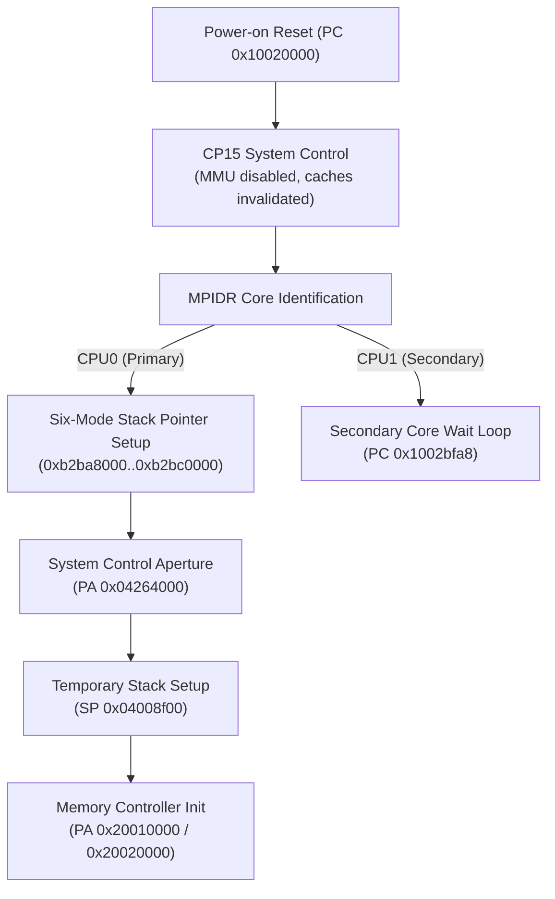

# Z7II C1.70 MAS initial execution and bootstrap boundary

This document defines the primary CPU bootstrap sequence and hardware contract for the Nikon Z7II (C1.70) Main Application System (MAS) Cortex-A7 domain.

## Boot sequence and early execution flow

Upon power-on reset, CPU0 initiates architectural initialization, configures CPU core registers, and executes initial system configuration writes before branching to memory initialization routines.

## Architectural initial state

| Register / Parameter | Architectural Reset Value | Specification & Meaning |
|---|---|---|
| Program Counter (`PC`) | `0x10020000` | Vector base in mapped flash/ROM |
| CPSR | `0x400001d3` | ARM state, Supervisor (SVC) mode, IRQ/FIQ masked |
| General Registers | `r0..r12 = 0` | Standard CPU architectural state |
| Stack Pointer (`SP`) | `0x00000000` | Uninitialized until mode setup at `0x1002bc88` |
| Primary Instruction | `0xea002f20` (`b 0x1002bc88`) | Jump to core initialization trampoline |

## System control aperture contract (`0x04264000`)

The earliest MMIO transaction issued by unchanged MAS firmware targets the system configuration controller at `PA 0x04264000`:

| Offset | Width | Value | Operation | Functional Contract |
|---|---|---|---|---|
| `+0x00` | 32-bit | `0x00000021` | Write | Master clock multiplier and core reset release |
| `+0x20` | 32-bit | `0x153b0902` | Write | Core frequency divider and bus clock configuration |
| `+0x00` | 32-bit | Bit 3 RMW | Read-Modify-Write | Flash page table attribute transition gating |

### Operational rules
1. **Write Retention**: Stores to `+0x00` and `+0x20` retain full 32-bit configuration words.
2. **Read-Modify-Write Semantics**: Subsequent memory management routines in RAM2 (Thumb VA `0xb2bb0692..0xb2bb06bc`) read `+0x00`, toggle bit 3, and write back to signal translation table attribute switches.
3. **Strict Boundary Checking**: Accesses with unaligned offsets, invalid widths, or out-of-bounds addresses return `MEMTX_ERROR` and halt the virtual machine for diagnostic inspection.

## Temporary stack allocation

Following `0x04264000` initialization, original code at `0x1002bdb0` switches to a temporary bootstrap stack at `0x04008f00` before calling initialization helpers.

- **Mapped Region**: `[0x04008ea8, 0x04008f00)` (88 bytes).
- **Stack Usage**: 8 bytes for wrapper preservation, 40 bytes for SDI callee frames, and 40 bytes for calibration training frames.
- **Contract**: The emulator maps this exact finite aperture; memory outside this window remains unmapped to detect stack overflows.
