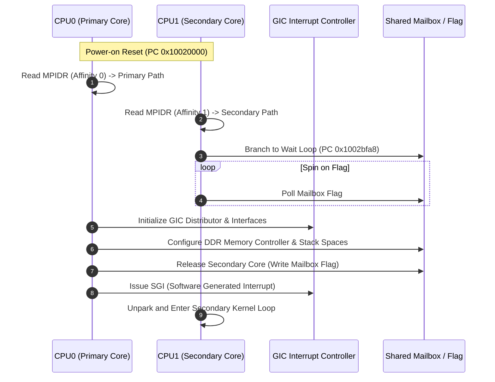

# Dual-core SMP reset and core synchronization

This specification describes the multi-core Cortex-A7 symmetric multiprocessing (SMP) startup protocol, MPIDR topology evaluation, and secondary core parking mechanisms in the Nikon Z7II MAS domain.

## Multi-core bootstrap architecture

Both Cortex-A7 cores initiate execution simultaneously from reset vector `0x10020000`. Using the Multiprocessor Affinity Register (`MPIDR`), each core identifies its architectural role.



## MPIDR evaluation logic

The instruction stream at `0x1002bc88` inspects MPIDR:

```armasm
mrc     p15, 0, r0, c0, c0, 5    @ Read MPIDR
ands    r0, r0, #0x03            @ Mask CPU ID bits [1:0]
beq     primary_init             @ CPU0: branch to global init
b       secondary_park           @ CPU1: branch to parking loop (0x1002bfa8)
```

## Core responsibilities

| Core | Role | Initial Tasks | Steady-State Tasks |
|---|---|---|---|
| **CPU0** | Primary Master | Hardware clock configuration, CP15 MMU translation tables, GIC distribution, SDI memory controller training, NOR descriptor intake | Application services, GUI state machine, event routing, communication with EX/SLA |
| **CPU1** | Worker / Secondary | Spin-waits at `0x1002bfa8` until primary sets initialization ready flag | Intensive image processing, pipeline transformations, background computation |

## Architectural invariants

1. **Independent Register State**: Both cores possess separate architectural register files, Program Status Registers (`CPSR`/`SPSR`), and private bank registers for each CPU mode (SVC, IRQ, ABT, UND, SYS).
2. **Memory Barriers**: The original assembly contains mandatory Data Memory Barriers (`DMB`), Data Synchronization Barriers (`DSB`), and Instruction Synchronization Barriers (`ISB`) to enforce strict order between memory initialization and secondary core unparking.
3. **Execution Safety**: When unmodeled peripheral accesses halt CPU0 with `MEMTX_ERROR`, CPU1 remains safely contained in its spin loop without causing unpredictable bus corruption.
